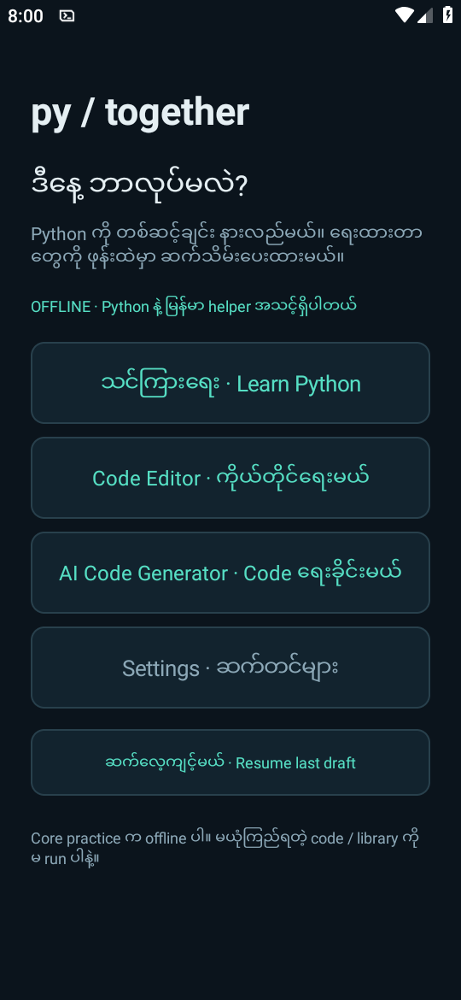
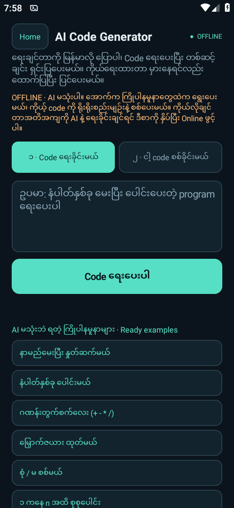
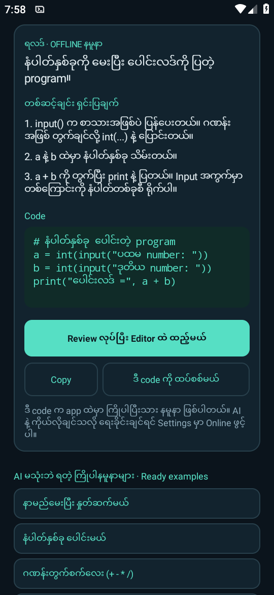
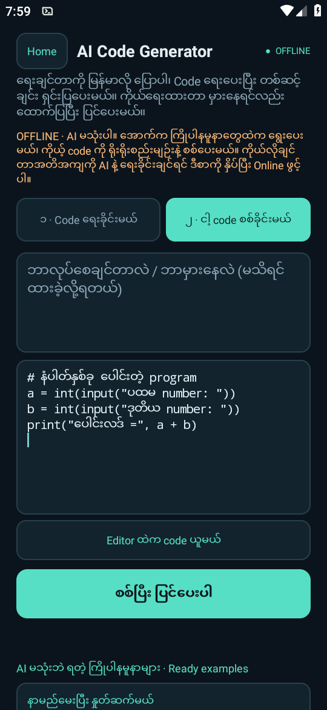
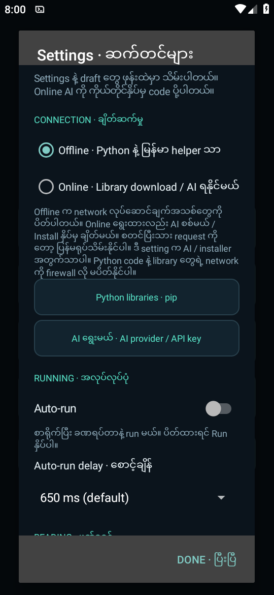

# PyTogether

A phone-first Android app for learning Python step by step, with a built-in code editor, a Burmese-language helper and an optional AI code generator. The interface is mainly Burmese with English labels.

> **Pre-release 0.4.0 (`0.4.0-codegen`).** The AI parts have been tested on an Android 9 emulator with a fake provider only. **Testing on a real phone with a real AI provider is still pending.** Expect rough edges.

| Home | AI Code Generator | Offline recipe result |
|---|---|---|
|  |  |  |

| Check my code | Settings: Offline / Online |
|---|---|
|  |  |

## What it does

- **Learn Python**: six short lessons with an editor, output and an optional "data-flow" view. Drafts are saved per lesson.
- **Code Editor**: free practice with Python 3.11 running on the phone (via Chaquopy).
- **Helper (offline)**: explains errors in Burmese using local rules, and offers conservative fixes that you review before accepting.
- **AI Code Generator (new in 0.4.0)**: describe a program in Burmese and get code, step-by-step explanations and a review step before anything goes into the editor. A second tab checks your own code and points out mistakes.
- **Python libraries**: install pure-Python packages from PyPI into app-private storage (only when Online is on).

## The AI features are optional

- **Nothing AI-related is bundled.** There is no API key, account or subscription in this app or in this repository. You add your own key in *Settings > AI provider / API key*.
- **Offline is the default.** In Offline mode the AI generator uses a small set of built-in example recipes and never contacts any server.
- **Online mode sends your text to the provider you choose.** When you switch Settings to *Online* and use the generator or the AI check, your request, and your code if you ask for a check, is sent over HTTPS to the endpoint you configured (presets: OpenCode Zen, OpenAI, OpenRouter, Gemini, DeepSeek, Groq, or a custom OpenAI-compatible URL). The app asks before sending existing code. That provider's privacy terms, retention and charges apply to you.
- **Keys** are encrypted on the device with Android Keystore (AES-GCM), kept per provider, never shown again and never written to logs.
- AI answers can be wrong. The app never runs generated code on its own, and it shows the old and new code side by side before you accept a change. Read it before you run it.
- The provider presets are conveniences. Check the endpoint and model name in your provider's own documentation.

## Install

Download `PyTogether-0.4.0-codegen.apk` from the [Releases page](../../releases), and allow installs from your browser or file manager when Android asks. It needs Android 7.0 (API 24) or newer, on arm64 or x86_64.

The APK is signed with the same debug-style key as the earlier PyTogether builds (package `com.zynelabs.pytogether`), so it installs over them as an update. That key is not in this repository. If you build from source you will get a different signature, and you would have to uninstall the released version first.

## Build from source

You need JDK 17, the Android SDK (API 34), and a local Python 3.11 (Chaquopy needs one at build time).

```sh
echo "sdk.dir=$HOME/Android/Sdk" > local.properties
./gradlew assembleDebug -Ppt.buildPython=/path/to/python3.11
# APK: app/build/outputs/apk/debug/app-debug.apk
```

Optional signing: put `pt.keystore`, `pt.storePassword`, `pt.keyAlias` and `pt.keyPassword` in `~/.gradle/gradle.properties`. Otherwise Android's default debug key is used.

Python unit tests (run on a computer): `python3 -m unittest discover -s tests -p "test_*.py"`. The on-device suites in `app/src/androidTest` are run with `adb shell am instrument`; their last results are in `tests/`.

## Safety notes

PyTogether is not a hardened sandbox: Python code and installed packages run with the app's own permissions, including its Internet permission. Do not run code or install libraries you do not trust, especially if you have saved an AI key. See [docs/DETAILS.md](docs/DETAILS.md) for the full design notes (written mostly in Burmese).

## မြန်မာလို အကျဉ်း

PyTogether က Python ကို တစ်ဆင့်ချင်း သင်ယူဖို့ Android app ပါ။ 0.4.0 မှာ **AI Code Generator** ထပ်ပါလာပါတယ်။ AI က **မဖြစ်မနေ မလိုပါ**။ Offline (default) မှာ အသင့်ပါတဲ့ နမူနာတွေကိုပဲ သုံးပြီး ဘာမှ ပို့မနေပါဘူး။ AI သုံးချင်ရင် Settings မှာ Online ဖွင့်ပြီး ကိုယ်ပိုင် API key ထည့်ရပါမယ်။ Online မှာ ရေးခိုင်းတဲ့စာ (နဲ့ စစ်ခိုင်းတဲ့ code) ကို ရွေးထားတဲ့ provider ဆီပဲ ပို့ပါတယ်။ ဒီ app ထဲမှာ key မပါပါဘူး။ AI အပိုင်းကို ဖုန်းအစစ်နဲ့ မစမ်းရသေးပါဘူး။

## License

GPL-3.0-only. See [LICENSE](LICENSE). Third-party components and their licences are listed in [NOTICE](NOTICE).
